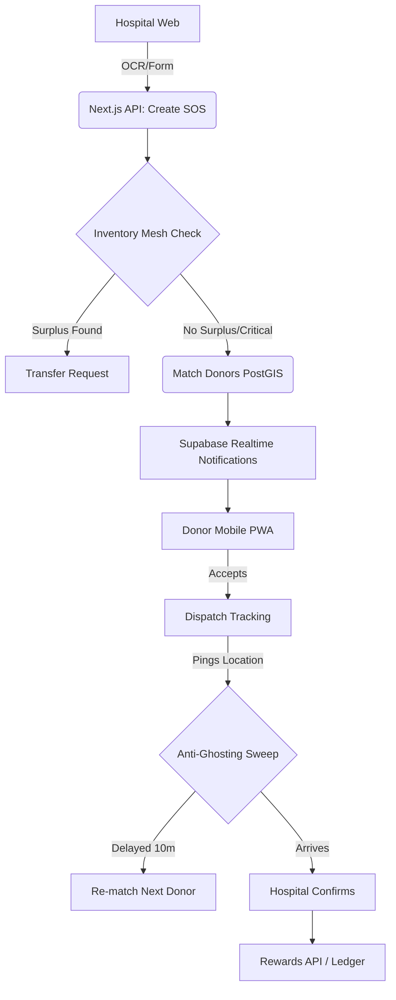

# RakshaRakt - Emergency Blood Donation Platform

## Problem
In critical emergencies, hospitals often face immediate blood shortages. Relying on passive donation camps or uncoordinated social media blasts leads to delays, mismatched donors, and "ghosting" (donors who promise to come but don't).

## Solution
RakshaRakt is an intelligent, real-time emergency broadcast system:
- **Smart Matching:** AI-driven exact & compatible group matching.
- **Inventory Mesh:** Checks nearby hospitals for surplus stock *before* alarming civilians.
- **Dynamic Radius:** Starts at 5km, auto-escalates to 50km for critical needs.
- **Anti-Ghosting:** Live donor location tracking. If a donor stalls for 10 minutes, the system automatically marks them as ghosted and sweeps for the next available replacement.
- **Gamification:** Hero points, verifiable badges, and partner coupons to encourage reliability.

### 📱 Offline SMS Fallback (Concept)
While the current MVP uses web-push simulated via Supabase Realtime, a production deployment would integrate **Twilio SMS** to fallback for donors without data connectivity or smartphones, bridging the digital divide in rural areas.

## Architecture

## Features Implemented vs Stretch Ideas
- ✅ **AI Parsing:** Gemini 1.5 parsing handwriting
- ✅ **Anti-Ghosting:** Geo-tracked sweep & auto-replacement
- ✅ **Gamification:** Points and coupon ledger
- ❌ **Web Push / PWA:** Skipped for MVP constraints (using in-app Realtime)
- ❌ **SMS Twilio:** Mentioned but not built for hackathon
- ❌ **Hardware SOS Button:** Out of scope

## Setup
1. Clone repo: `git clone https://github.com/Kabirgupta3632/Cline_Project.git`
2. `cd Cline_Project && npm install`
3. Configure `.env.local` with Supabase keys and Gemini API key.
4. Run `npm run dev`.
5. Run `db/seed.sql` in Supabase SQL Editor.

## Demo Flow (3 min)
1. **Hospital:** Uploads handwritten slip -> AI OCR extracts O- Critical -> SOS created.
2. **Mesh:** System detects surplus O- at a neighbour, but hospital chooses "Broadcast anyway".
3. **Donor:** Receives notification on simulated phone, taps "Yes".
4. **Demo Panel:** Operator clicks "Time Warp +11m" -> Donor ghosted, replacement instantly notified on timeline.
5. **Hospital:** New donor arrives, clicks Confirm -> Points awarded, Night Owl badge unlocked.
6. **Impact:** Show Rewards tab on donor profile with new coupon available.

---
_Built with Cline during the AI Builders Hackathon._
