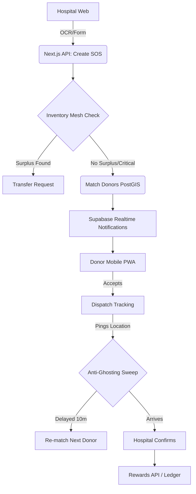

# RakshaRakt - Emergency Blood Donation Platform

## Problem
In critical emergencies, hospitals often face immediate blood shortages. Relying on passive donation camps or uncoordinated social media blasts leads to delays, mismatched donors, and "ghosting" (donors who promise to come but don't).

## Solution
RakshaRakt is an intelligent, real-time emergency broadcast system:
- **Smart Matching:** AI-driven exact & compatible group matching.
- **Inventory Mesh:** Checks nearby hospitals for surplus stock *before* alarming civilians.
- **Dynamic Radius:** Starts at 5km, auto-escalates to 50km for critical needs.
- **Anti-Ghosting:** Live donor location tracking. If a donor stalls for 10 minutes, the system automatically marks them as ghosted and sweeps for the next available replacement.
- **Gamification:** Hero points, verifiable badges, and partner coupons to encourage reliability.

### 📱 Offline SMS Fallback (Concept)
While the current MVP uses web-push simulated via Supabase Realtime, a production deployment would integrate **Twilio SMS** to fallback for donors without data connectivity or smartphones, bridging the digital divide in rural areas.

## Architecture

## Features Implemented vs Stretch Ideas
- ✅ **AI Parsing:** Gemini parsing handwriting (deterministic mock fallback when no API key)
- ✅ **Inventory Mesh:** surplus check across nearby hospitals before any civilian broadcast
- ✅ **Smart matching guards:** dispatch fatigue cap, quiet hours (23:00-06:00, normal SOS only), hospital verification gate - see `docs/API_CONTRACT.md`
- ✅ **Anti-Ghosting:** Geo-tracked sweep & auto-replacement, with `dispatch_events` timeline
- ✅ **Gamification:** Points, badges and coupon ledger
- ✅ **PWA + local notifications:** installable donor app, Realtime-driven alerts, Hindi/Assamese toggle
- ❌ **SMS Twilio:** Mentioned but not built for hackathon
- ❌ **Hardware SOS Button:** Out of scope

## Setup
1. Clone repo: `git clone https://github.com/Kabirgupta3632/Cline_Project.git`
2. `cd Cline_Project && npm install`
3. Copy `.env.local.example` to `.env.local` and fill in the Supabase project URL,
   anon (publishable) key and service_role (secret) key. `GEMINI_API_KEY` is
   optional - the AI routes fall back to a deterministic mock without it.
   **Never commit `.env.local`** (it is git-ignored; ask a teammate for the keys privately).
4. Set up the database. In the Supabase SQL Editor run these files **in this exact order**
   (each depends on the previous one). Files 1-3 and 5 are safe to re-run; file 4
   will error on a second run because its `CREATE POLICY` lines aren't guarded - just skip it:
   1. `db/schema.sql` - PostGIS extension, enums, all tables, Realtime publication
   2. `db/functions.sql` - `match_eligible_donors`, `find_surplus_hospitals`, `get_*_latlng` RPCs
   3. `db/dispatch_functions.sql` - dispatch-only RPC placeholder (currently a no-op)
   4. `db/dispatch_events.sql` - `dispatch_events` timeline table used by cancel / ghost-sweep
   5. `db/seed.sql` - 3 Guwahati hospitals, 25 donors, inventory, coupons
5. Run `npm run dev` and open http://localhost:3000.
6. (Optional) Verify: `GET /api/roles/seed-options` should return 3 hospitals and 25 donors.

### Demo tuning knobs (`.env.local`)
| Variable | Default | Lower it for a live demo so... |
|---|---|---|
| `DEMO_ESCALATION_SECONDS` | `300` | critical SOS radius widens every few seconds instead of minutes |
| `GHOST_WINDOW_MIN` | `10` | a stalled donor is ghosted & replaced within a minute |
| `AVG_SPEED_KMH` / `ETA_BUFFER_MIN` | `25` / `2` | ETA math (rarely needs changing) |

Hit `POST /api/demo/reset` (or the **Reset** button on `/demo`) before presenting to
clear all SOS / dispatch / reward activity while keeping the seed data.

> Note: rule 6 (smart quiet hours) suppresses **normal**-urgency broadcasts between
> 23:00-06:00 server time. If demoing late at night, use **critical** urgency
> (which always bypasses quiet hours) or adjust `QUIET_HOURS_*` in `lib/matching.ts`.

## Demo Flow (3 min)
1. **Hospital:** Uploads handwritten slip -> AI OCR extracts O- Critical -> SOS created.
2. **Mesh:** System detects surplus O- at a neighbour, but hospital chooses "Broadcast anyway".
3. **Donor:** Receives notification on simulated phone, taps "Yes".
4. **Demo Panel:** Operator clicks "Time Warp +11m" -> Donor ghosted, replacement instantly notified on timeline.
5. **Hospital:** New donor arrives, clicks Confirm -> Points awarded, Night Owl badge unlocked.
6. **Impact:** Show Rewards tab on donor profile with new coupon available.

---
_Built with Cline during the AI Builders Hackathon._
