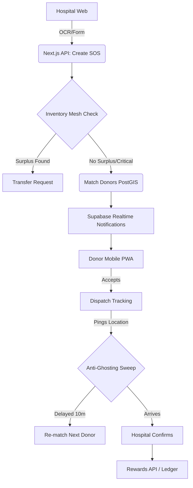

# RakshaRakt - Emergency Blood Donation Platform

## Problem
In critical emergencies, hospitals often face immediate blood shortages. Relying on passive donation camps or uncoordinated social media blasts leads to delays, mismatched donors, and "ghosting" (donors who promise to come but don't).

## Solution
RakshaRakt is an intelligent, real-time emergency broadcast system:
- **Smart Matching:** AI-driven exact & compatible group matching.
- **Inventory Mesh:** Checks nearby hospitals for surplus stock *before* alarming civilians.
- **Dynamic Radius:** Starts at 5km, auto-escalates to 50km for critical needs.
- **Anti-Ghosting:** Live donor location tracking. If a donor stalls for 10 minutes, the system automatically marks them as ghosted and sweeps for the next available replacement.
- **Gamification:** Hero points, verifiable badges, and partner coupons to encourage reliability.

## Architecture

## Features
- **SOS Creation & AI Slip OCR:** Gemini parses hand-written requisition slips.
- **Live Dispatch Dashboard:** Real-time ETAs and progress bars for the hospital.
- **Anti-Ghosting Engine:** Re-routes automatically if a volunteer isn't moving.
- **Rewards System:** Point ledger, coupons, and dynamic badges (First Responder, Night Owl).

## Setup
1. Clone repo, `npm install`
2. Configure `.env.local` with Supabase keys and Gemini API key.
3. Run `npm run dev`.
4. Run `seed.sql` in Supabase SQL Editor.

## Demo Flow (3 min)
1. **Hospital:** Uploads slip -> SOS created.
2. **Mesh:** System detects surplus O- at a neighbour, but hospital chooses "Broadcast anyway" (Critical).
3. **Donor:** Receives notification, taps "Yes".
4. **Demo Panel:** Trigger "Time Warp +11m" -> Donor ghosted, replacement instantly notified.
5. **Hospital:** Confirm arrival -> Points awarded, Night Owl badge unlocked.

## Tech Used
Next.js 14, Supabase (Postgres, PostGIS, Realtime), Tailwind CSS, Gemini 1.5 API.
